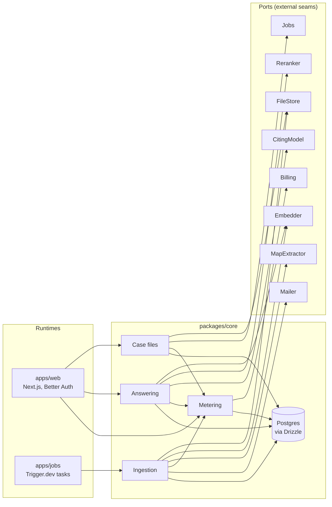
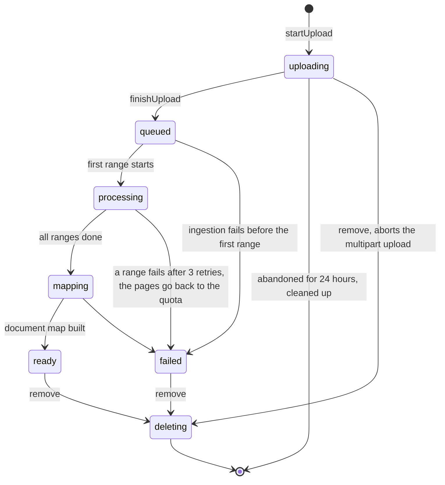

# Architecture

Consta is four deep modules (Case files, Ingestion, Answering, Metering) in one TypeScript package, called from two runtimes: the Next.js app and Trigger.dev tasks. External services and the database sit behind small ports with a production adapter and an in-memory fake. Each module owns a repository port for its tables, and a `UnitOfWork` port runs work in one transaction (ADR-0006).

Terms follow [`CONTEXT.md`](../CONTEXT.md) for the domain and the codebase-design vocabulary (module, interface, seam, adapter, depth) for the code. Decisions are in [`docs/adr/`](./adr/).

## Shape



The web app's screens only call Case files and Answering, plus `Plans`, the part of the Metering interface for paying; its sign-in calls Metering once, to give a new lawyer the Trial plan, and the operator's cost page reads Metering's costs. The task runtime only calls Ingestion. Modules never call each other's internals; Case files starts Ingestion through the `Jobs` port, not by importing it. Ingestion changes a case file's status through `CaseFileLifecycle`, the part of the Case files interface for the task runtime, which runs without a lawyer.

## Modules

| Module | What callers know (interface) | What it hides (implementation) | Called by |
| --- | --- | --- | --- |
| **Case files** | Start and finish an upload, view, list, get a read URL, remove; a view says whether the case file is still ingesting. `CaseFileLifecycle`: the status changes of ingestion, each safe to run again, and failing, which gives the pages back | Status lifecycle, which statuses count as ingesting, retry-safety of every ingestion step, page-quota check, the pages given back on failure, multipart upload bookkeeping, ownership checks, ordered deletion of every derived row and the stored PDF | `apps/web`; `CaseFileLifecycle` by Ingestion |
| **Ingestion** | `ingest` runs it all, with a `RangeRunner` that runs the ranges in-process or as Trigger.dev tasks; `ingestRange` for such a runner, `giveUp` when a run dies. Every method is idempotent | The step order, attempts per step and per range, the failure reason, page classification, text and block extraction of digital pages (scanned pages are marked as not read, ADR-0010), folha detection, passage splitting inside a page, embedding, document map windowing and merging, facts, progress, the ready email | `apps/jobs`, the inline `Jobs` adapter |
| **Answering** | `ask` returns a stream of statements, each with at least one citation | Scope handling, hybrid search and reranking, source blocks per page, token budget, prompt caching, citation-to-page resolution, dropping uncited statements, saving the question, metering | `apps/web` |
| **Metering** | `record` usage, `startTrial` and `pagesLeft` for a lawyer, `chargePages` and `givePagesBack` for a case file, `costs` of a month. `Plans`: a lawyer's plan view, the Checkout and billing portal URLs, and the billing webhook | Cost per provider and unit, the monthly page-quota window (`Month`, in São Paulo), the page quota of each plan, which billing state means Pro, one Checkout at a time, stale and repeated webhooks | The other three modules, the web app's sign-in, plan page and Stripe webhook, the operator page |

Each module is a folder whose `index.ts` is its whole interface. Code outside the folder imports only from `index.ts`; a lint rule (`no-restricted-imports` on deep paths) enforces it.

### Why these four

- **Answering is the deepest module and the reason the product exists.** The rule "no citation, no statement" lives in one place, so it is fixed once and tested once (ADR-0003).
- **Ingestion owns all page-level knowledge.** Classification, OCR and the rule that a passage never crosses a page break stay together. Splitting them into a "parser", an "OCR service" and an "indexer" would create shallow modules that must agree on page and block formats across three interfaces.
- **Case files owns the lifecycle.** Status changes, quota and deletion rules sit in one module instead of being spread across route handlers.
- **Metering passes the deletion test.** Without it, cost lookup and quota maths would reappear in the other three modules.

### Domain rules the modules enforce

- **A citation names the PDF page and, when the page has one, its folha.** Ingestion detects the stamped folha; Answering adds it to each citation.
- **Every upload is a new case file**, even a newer download of the same lawsuit. Updating an existing case file comes after the pilot.
- **Pages count against the page quota once ingested** and are not given back when a case file is deleted. They are charged when the upload finishes and given back if ingestion fails.
- **A lawyer owns case files directly.** When firms arrive, a firm workspace will own case files and lawyers will belong to it; module interfaces take a `LawyerId` today and will take the owner instead.

## Interfaces

Sketches. They name every fact a caller must know, including order and error modes.

```ts
// packages/core/src/case-files/index.ts
export class CaseFiles {
  constructor(deps: { uow: UnitOfWork; files: FileStore; jobs: Jobs; metering: Metering });
  /** The browser reads the page count with pdf.js first. Throws QuotaExceeded before any upload starts. */
  startUpload(lawyer: LawyerId, file: { name: string; bytes: number; pages: number }): Promise<{ caseFileId: CaseFileId; uploadId: string }>;
  signUploadPart(lawyer: LawyerId, caseFileId: CaseFileId, partNumber: number): Promise<string>;
  uploadedParts(lawyer: LawyerId, caseFileId: CaseFileId): Promise<UploadedPart[]>; // lets the browser resume
  /** Closes the upload, recounts pages, re-checks the quota, then starts ingestion. Idempotent. */
  finishUpload(lawyer: LawyerId, caseFileId: CaseFileId): Promise<CaseFileView>;
  view(lawyer: LawyerId, caseFileId: CaseFileId): Promise<CaseFileView>; // status, progress, document map, folha of each page
  list(lawyer: LawyerId): Promise<CaseFileSummary[]>;
  readUrl(lawyer: LawyerId, caseFileId: CaseFileId): Promise<string>; // signed, supports HTTP range requests
  remove(lawyer: LawyerId, caseFileId: CaseFileId): Promise<void>;
}
```

```ts
// packages/core/src/ingestion/index.ts
/** Runs ingestRange for each range, 4 attempts at most, and returns the ranges that failed on every attempt. */
export interface RangeRunner {
  run(caseFileId: CaseFileId, ranges: PageRange[]): Promise<PageRange[]>;
}

/** Every method can run again on the same case file. */
export class Ingestion {
  // Ticket 13 adds the Mailer.
  constructor(deps: { uow: UnitOfWork; files: FileStore; embedder: Embedder; mapExtractor: MapExtractor; metering: Metering }); // builds its own CaseFileLifecycle
  /**
   * Plans, has `ranges` run the ranges (in-process by default), builds the document map and facts
   * from windows of pages, and marks the case file ready with its unread scanned pages. Unread ranges fail it with a reason naming their pages; any other
   * failure fails it with a general reason and is rethrown. Failing gives the pages back to the quota.
   */
  ingest(caseFileId: CaseFileId, ranges?: RangeRunner): Promise<void>;
  /** For a RangeRunner. A retry replaces the pages and passages of that range only. */
  ingestRange(caseFileId: CaseFileId, range: PageRange): Promise<void>;
  /** Fails the case file with a general reason when the run itself dies, unless it is ready or already failed. */
  giveUp(caseFileId: CaseFileId): Promise<void>;
}

// packages/core/src/case-files/lifecycle.ts
/**
 * Each method locks the case file row and joins the caller's run. A step the case file is
 * already at, or past on the way to ready, does nothing.
 */
export class CaseFileLifecycle {
  constructor(deps: { uow: UnitOfWork; metering: Metering });
  target(caseFileId: CaseFileId): Promise<IngestionTarget>; // lawyer, storage key, size, page count, status
  startProcessing(caseFileId: CaseFileId): Promise<void>;
  recordPagesRead(caseFileId: CaseFileId, pages: number): Promise<void>; // only goes up
  startMapping(caseFileId: CaseFileId): Promise<void>;
  /** `scannedPages`: the numbers of the pages not read, in order. */
  markReady(caseFileId: CaseFileId, scannedPages: number[]): Promise<void>;
  /** Gives the pages back to the quota. A ready or failed case file stays as it is. */
  fail(caseFileId: CaseFileId, reason: string): Promise<void>;
}
```

```ts
// packages/core/src/answering/index.ts
export class Answering {
  constructor(deps: { uow: UnitOfWork; embedder: Embedder; reranker: Reranker; model: CitingModel; metering: Metering });
  /** Yields `refused: "not-ready"` unless the case file is ready, `refused: "scope-too-large"` for a peça over the budget, and `refused: "not-readable"` for a peça of scanned pages only; then each cited statement, then `done`; `refused: "declined"` ends it when the model declines. Throws NotFound for a case file or peça the lawyer can't ask about. */
  ask(lawyer: LawyerId, question: QuestionInput): AsyncIterable<AnswerEvent>;
}

export type QuestionInput =
  | { caseFileId: CaseFileId; scope: Scope; text: string }
  | { caseFileId: CaseFileId; summarize: PecaId } // a peça question saved as PECA_SUMMARY_TEXT; the model is asked PECA_SUMMARY_PROMPT
  | { caseFileId: CaseFileId; quickAction: "timeline" | "people" | "amounts" };

export type Scope = { kind: "whole-file" } | { kind: "peca"; pecaId: PecaId };

export type AnswerEvent =
  | { type: "statement"; statement: Statement }
  | { type: "refused"; reason: "not-ready" | "scope-too-large" | "not-readable" | "declined" }
  | { type: "done"; questionId: QuestionId; dropped: number; unreadPages: UnreadPages }; // dropped = uncited statements removed; unreadPages = scanned pages of a peça left out

export type Statement = { text: string; citations: [Citation, ...Citation[]] }; // never empty, by type
export type Citation = { page: number; folha: string | null; quote: string; boxes: Box[] };
```

```ts
// packages/core/src/metering/index.ts
export class Metering {
  constructor(deps: { uow: UnitOfWork });
  record(lawyer: LawyerId, caseFileId: CaseFileId | null, usage: Usage[]): Promise<void>;
  /** On a lawyer's first sign-in. A lawyer who already has a plan keeps it. */
  startTrial(lawyer: LawyerId): Promise<void>;
  pagesLeft(lawyer: LawyerId): Promise<number>;
  /** Checks and charges in one transaction; throws QuotaExceeded. Idempotent per case file. */
  chargePages(lawyer: LawyerId, caseFileId: CaseFileId, pages: number): Promise<void>;
  /** For the operator: cost per lawyer and per case file, by usage kind, most expensive first. */
  costs(month: Month): Promise<CostReport>;
}

// packages/core/src/metering/plans.ts, exported from metering/index.ts
export class Plans {
  constructor(deps: { uow: UnitOfWork; billing: Billing; metering: Metering });
  view(lawyer: LawyerId): Promise<PlanView>; // plan, page quota, pages left, whether they have billing to manage; starts a missing Trial
  /** Trial: a billing customer, then Checkout for Pro. Already paying, even before the webhook: the billing portal, so no one pays twice. Throws NotOnTrial for a plan set outside Checkout. */
  checkoutUrl(lawyer: LawyerId, email: string, returnUrl: string): Promise<string>;
  /** Throws NotFound for a lawyer who never opened Checkout. */
  portalUrl(lawyer: LawyerId, returnUrl: string): Promise<string>;
  /** The webhook names a billing customer; whether they pay is read from the provider now, so repeated, late or same-second events end on its current state. Paying: Pro and its page quota; not: Trial. Throws InvalidWebhook. */
  receiveWebhook(payload: string, signature: string): Promise<void>;
}
```

```ts
// packages/core/src/ports/unit-of-work.ts
/**
 * Runs work in one transaction and rolls it back when the work throws. A run
 * inside a run joins the outer transaction, so a module can call another
 * module's method inside its own run and both commit together.
 */
export interface UnitOfWork {
  run<T>(work: (repos: Repositories) => Promise<T>): Promise<T>;
}

/** Every module's repository, bound to the current transaction. */
export type Repositories = {
  caseFiles: CaseFileRepository;
  ingestion: IngestionRepository;
  answering: AnsweringRepository;
  metering: MeteringRepository;
};
```

A module reads and writes only its own repository from `repos`. To change another module's data, it calls that module's interface inside the same run. For example, `finishUpload` runs `metering.chargePages` and `repos.caseFiles.markQueued` in one run: the quota rule stays in Metering, and both writes commit or roll back together. Calls to external services stay outside the run (ADR-0007): `finishUpload` asks `Jobs` to start ingestion only after the run commits. Each module's repository type lives in its folder; the Drizzle adapters live in `src/db/repositories/`, the fakes in `src/ports/fakes/`.

## Seams and adapters

Each port is a real seam: it has a production adapter and an in-memory fake used by tests. Ports are shaped by what Consta needs, not by the vendor's API.

| Port | What it does | Production adapter | Test adapter |
| --- | --- | --- | --- |
| `FileStore` | Multipart upload, signed read URL, download, remove | S3-compatible client (MinIO locally, Cloudflare R2 now, AWS S3 in São Paulo later) | In-memory store |
| `Ocr` (later, ADR-0010) | Reads a PDF of scanned pages into text blocks with bounding boxes and confidence | Mistral OCR, when ticket 06 adds it again | Returns fixture text |
| `Embedder` | Embeds passages and questions | Voyage | Deterministic hash vectors |
| `Reranker` | Orders passages for a question | Voyage | Keeps the input order |
| `CitingModel` | Answers from source blocks, returning text with the blocks of the sources it cites | Claude Sonnet with native citations | Scripted answers, including uncited ones |
| `MapExtractor` | Reads a window of pages and returns peças and facts | Claude Haiku 5.5, one Messages call per window with structured output | Scripted peças and facts |
| `Jobs` | Starts ingestion of a case file | Trigger.dev, with the case file id as the idempotency key, in both adapter modes (ADR-0009) | Inline: runs `Ingestion.ingest` in-process and returns at once (the E2E server, `CONSTA_JOBS=inline`). Recording: records the request only (tests that run the steps themselves) |
| `Mailer` | Sends a templated email | Resend | In-memory outbox |
| `Billing` | A customer per lawyer, hosted Checkout for Pro and the billing portal, whether a customer pays now; reads a signed webhook as the customer it names | Stripe Customers, Checkout (other open sessions expired first) and Customer Portal; paying is any active, trialing or past-due subscription to Pro's price | Stripe-like URLs that E2E intercepts in the browser; webhooks signed with a per-process secret, so none can be forged. Used in fake mode unless `STRIPE_SECRET_KEY` is set |
| Repositories (one per module) | Read and write the module's tables, including hybrid search | Drizzle on Postgres | In-memory tables |
| `UnitOfWork` | Runs work in one transaction with repositories bound to it | Drizzle transaction | Copies the in-memory state and restores it if the work throws |

Every port that calls an AI provider returns `usage` with its result, and the calling module passes it to Metering.

### Not seams

| Dependency | Why it has no port | How tests handle it |
| --- | --- | --- |
| pdf.js, pdf-lib | In-process libraries. Case files counts the pages of a stored PDF with pdf.js, which reads only the byte ranges it needs through `FileStore.read` | Fixture PDFs, made with pdf-lib in the tests |
| Better Auth | Used only in `apps/web`; modules receive a `LawyerId`, which is the Better Auth user id | Module tests pass a `LawyerId`; `apps/web` tests sign in through Better Auth on PGlite |
| Trigger.dev task definitions | They are the `Jobs` adapter, not domain code | The inline `Jobs` adapter |

If the Phase 1 test needs a Python extractor, it becomes an internal seam inside Ingestion, not a port in the module's interface.

## Case file lifecycle



Questions are accepted only in `ready`. Any other state makes `ask` return `refused: "not-ready"`.

The `CaseFile` entity in the Case files module owns this lifecycle (ADR-0007). Each arrow is one of its methods, and a method throws `InvalidStatus` for a move that the diagram does not show. No other code sets a status.

`finishUpload` does its work in this order:

1. Outside a run: close the multipart upload and count the pages of the stored PDF. These are external calls, and a rollback cannot undo them.
2. In one run: lock the case file row, charge the pages (`Metering.chargePages` locks the lawyer's plan row), call `CaseFile.queue` and save it.
3. After the commit: ask `Jobs` to start ingestion. If `Jobs` fails, the case file stays `queued`. A new `finishUpload` asks again, and Trigger.dev starts ingestion only once.

## Repository layout

```text
apps/
  web/                 Next.js: pages, route handlers, server actions, Better Auth; composition root
  jobs/                Trigger.dev tasks (ingest-case-file: plan, fan out ranges, map); composition root
packages/
  core/
    src/case-files/    module; index.ts is the interface
    src/ingestion/     module
    src/answering/     module
    src/metering/      module
    src/shared/        ids, value types and errors shared by the modules
    src/ports/         port types and their in-memory fakes
    src/db/            Drizzle schema, migrations, hybrid search SQL
  adapters/            r2-s3, voyage, anthropic, resend, trigger-jobs, stripe
  evals/               quality runs against real adapters; they cost money, so they run by hand
```

Dependencies point one way: `apps` import `core` and `adapters`; `adapters` import only `core/src/ports`; `core` never imports `adapters`. Each composition root picks adapters from environment variables.

## Testing

- **The interface is the test surface.** Each module is tested through its `index.ts` with in-memory repositories and the fake adapters. No tests reach into a module's internals.
- **Repositories are tested on Postgres.** Each Drizzle repository has integration tests on PGlite, and a contract test that its fake passes too.
- **One in-process end-to-end path.** With the inline `Jobs` adapter, a single test can upload a fixture PDF, run ingestion and ask a question without any network.
- **Fixture PDFs:** a short digital file, a short scanned file (its pages are marked as not read) and a two-column file.
- **Answering's key tests:** a scripted model answer with one uncited statement must yield `dropped: 1`, and every citation must resolve to the page and boxes of its source block.
- **Port contract tests** run against the fake on every pull request and against the real adapter nightly.
- **Quality** (correct pages, document map accuracy) is measured in `packages/evals` with real adapters, not in unit tests.

## Changes from the PRD

| PRD | Now | Why |
| --- | --- | --- |
| `SearchIndex`, database, `TextExtractor` and `Auth` listed as ports | Not ports, except the database: each module has a repository port (ADR-0006) | `TextExtractor` and `Auth` would have one real adapter, or live only in the app; search is a method of Answering's repository |
| One generic `LlmClient.complete(role, request)` | Two ports shaped by use: `CitingModel` and `MapExtractor` | A generic port makes every caller handle citations and output parsing; the narrow ports keep that inside the adapter |
| Answers stream as text | Answers stream statement by statement | A statement can be shown only after its citations are known (ADR-0003) |
| Quota checked when the upload starts | Checked at start with the browser's page count, and checked again at finish with the real count | The page count isn't known on the server until the upload ends |
| Map extraction through the Message Batches API | Direct calls in the MVP | A batch result can take a long time to arrive, and waiting inside a task adds complexity. Direct calls cost about 2 USD more per 3,600-page case file; we can add batches behind the same port later. |
| Layered folders (`core` use cases, `adapters`, `db` as separate packages) | One `core` package organized by module | Changes stay inside one module folder instead of touching three layers |
