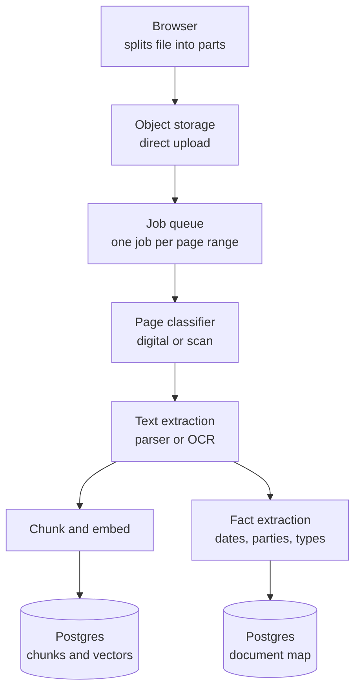
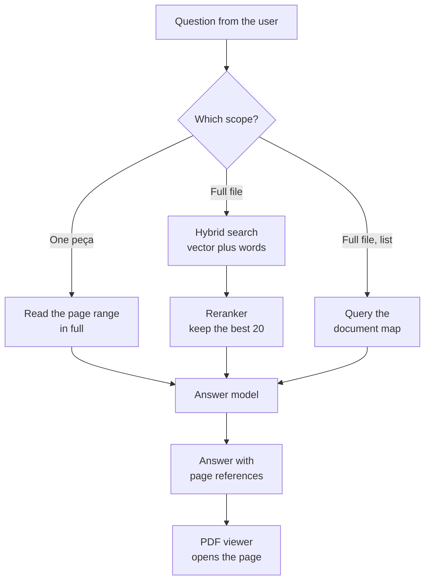

# Legal PDF Assistant: MVP Plan and Architecture

2026-09-19 · @Someone

## Language of this document

This document uses ASD-STE100 Simplified Technical English. The sentences are short. The voice is active. Each term has one meaning.

The table gives the technical names that this document uses.

| Technical name | Definition |
| --- | --- |
| Token | The unit of text that a language model reads. One token is about three quarters of an English word. |
| Context window | The maximum number of tokens that a model can read in one request. |
| Chunk | A small part of a document. The system stores each chunk as one database row. |
| Embedding | A list of numbers that gives the meaning of a chunk. The system compares embeddings to find related text. |
| Vector search | A search that compares embeddings. It finds text with a related meaning. |
| Lexical search | A search that compares words. It finds text with the same words. |
| Hybrid search | A search that does a vector search and a lexical search, then mixes the two result lists. |
| RAG | Retrieval-Augmented Generation. The system finds related text first, then gives that text to the model. |
| OCR | Optical Character Recognition. Software that reads text from an image of a page. |
| Peça | One document inside a case file. Examples are a petição inicial, a contestação and a sentença. |
| Document map | A table of the peças in one case file, with the type, the date and the page range of each one. |

## Purpose and scope

The product lets a lawyer ask questions about one very large case file, and gives each answer with a page reference.

One case file can have 3,600 pages. The file usually holds two types of page. Some pages come from a court system and contain digital text. Other pages are scans of paper, photographs of documents, or handwritten notes.

A case file of 3,600 pages holds about 2 to 3 million tokens. Portuguese text makes more tokens than English text of the same length. Thirteen models now have a context window of 1 million tokens or more, but no model can read the full file in one request. The system must therefore select the correct pages before it answers each question. ([context window comparison](https://www.morphllm.com/llm-context-window-comparison))

The first user is one lawyer. The MVP works on one case file at a time. The MVP does not search across more than one case file.

## Primary risks

Four risks decide if this product works. The upload and the progress display are not on this list, because they are the easy part.

| Risk | Effect | Control |
| --- | --- | --- |
| Bad text extraction | The parser reads a two-column page across both columns. It mixes two different sentences into one. The index then holds text that has no meaning. Every answer above it is wrong. | Classify each page before extraction. Use a parser that reads the page layout. Read 20 random pages by hand and compare them with the source. |
| Incomplete retrieval | The search returns 10 chunks out of 4,000. The model answers from those 10 chunks. The answer looks complete, but it is not complete. The user gets no warning. | Extract structured facts at ingest time. Answer questions about the full file with a database query, not with a search. |
| Wrong or missing page reference | The lawyer cannot check the answer. Courts have sanctioned lawyers for AI citations that do not exist. Sanctions have increased from 5,000 USD in 2023 to five figures and suspension in 2026. | Give every sentence a page number. Let the user open that page in the viewer. Show the source text. |
| Long ingest with no feedback | Ingest of 3,600 pages takes many minutes. The user thinks that the system has failed, and starts again. | Use a job queue that keeps its state. Report progress at page level, not at file level. |

The third risk is also the commercial opportunity. Research shows that legal tools with RAG still give an incorrect answer in 17 to 34 percent of tests. The difference between this product and a general chat product is not the quality of the summary. The difference is that the lawyer can check every sentence against a page.

Sources: [AI hallucination sanctions tracker](https://gc.ai/blog/ai-hallucination-legal-cases) · [Sanctions guide for lawyers](https://www.nexlaw.ai/blog/ai-hallucination-sanctions-2026/) · [PDF parse failures in RAG](https://www.buildmvpfast.com/blog/pdf-parsing-ai-apps-libraries-apis-edge-cases-2026)

## MVP scope

The MVP has six functions. Each one is necessary for the lawyer to trust an answer.

| Function | In the MVP | Note |
| --- | --- | --- |
| Upload one large PDF file | Yes | The browser sends the file directly to object storage. |
| Show progress for the upload and the ingest | Yes | Report the page number, not only the percentage of the file. |
| Make a document map | Yes | The system finds each peça, its type, its date and its page range. It writes a short summary of each one. |
| Ask a question about the case file | Yes | Each answer carries one or more page numbers. |
| Open a page reference in the viewer | Yes | The viewer opens the page and marks the source text. |
| Summarize a page range or one peça | Yes | The user selects the peça from the document map. |
| Search across more than one case file | No | Add this function after the first user is satisfied. |
| Collaboration, comments, shared workspaces | No | One user in the MVP. |
| Export an answer to a Word file | No | The user can copy the text. |
| A screen to correct OCR errors | No | Measure the error rate first. |
| Chat history and saved conversations | No | Not necessary to prove the concept. |
| A field for a user API key | No | See Cost controls. Add it in version 2 as a tier for a law firm, not as a cost control. |

The document map gives value before the user asks a question. A lawyer builds this index by hand today, and the work takes hours. The document map is therefore the first part of the product that a new user sees.

## The three question types

The system uses RAG, but RAG alone is not sufficient. A lawyer asks three different types of question. Each type needs a different method. One method for all three types fails on two of them.

| Type | Example | Method | Reason |
| --- | --- | --- | --- |
| Needle | "What is the date of the despacho on page 2840?" "Find each mention of Banco Safra." | Hybrid search. Mix the vector result list and the lexical result list. Then apply a reranker. | Two chunks about filing dates have almost the same embedding. A name that occurs one time is lost in a vector search. Word search finds it. |
| Scoped | "Summarize the sentença." "What is the conclusion of the laudo?" | Read the full page range. Do not search. | The document map gives the page range of the laudo. 58 pages is about 80,000 tokens, and a model can read that. A full read gives a better answer than six separate chunks. |
| Global | "List each witness." "Give me a timeline of the case." | Query the structured table that the ingest built. | A search of the first 10 results cannot be complete. The ingest process reads every page one time and writes the facts to a table. A query of that table is complete. |

The important rule is this one: search is for the questions where the system does not know where to look. When the system knows the page range, it must read those pages.

The MVP does not need a model to select the method. Give the user two controls instead. One control asks a question about the full case file. The other control asks a question about one peça from the document map. The lawyer usually knows which document she asks about. An explicit control is faster to build, and it is also a better product.

## Architecture: the ingest pipeline

The ingest pipeline runs one time for each case file. It is the expensive part of the system.

### Stage 1: the upload

The browser divides the file into parts of 5 MB to 10 MB. It sends each part directly to object storage with a signed URL. The application server does not carry the file data. The server only starts the upload session and closes it.

This design gives resume for free. If the connection stops, the completed parts stay in storage. The browser asks for the list of completed parts and continues from that point.

One configuration error is common: the storage service must expose the ETag header to the browser. Without this header, the browser cannot close a multi-part upload.

### Stage 2: the job queue

A job that processes 3,600 pages runs for many minutes. Use a queue that keeps the state of each step and retries one step after a failure. Do not use a simple background task.

The queue divides the file into page ranges and processes the ranges in parallel. Each range writes its progress to the database. The progress display reads that number.

### Stage 3: the page classifier

Examine each page before extraction. A page with digital text goes to a fast parser. A page that is an image goes to OCR. OCR is 100 times slower and more expensive than a parser. Send only the pages that need it.

### Stage 4: extraction, chunks and facts

The extraction step gives the text of each page and the position of each text block on that page. Keep the positions. The viewer needs them to mark the source text later.

The pipeline then does two different things with the text:

1. It divides the text into chunks. It calculates an embedding for each chunk. It writes the chunk, the embedding and the page number to the database.
2. It reads each page one time with a low-cost model. It extracts the document type, the dates, the names and the page range of each peça. It writes these facts to the document map table.

Step 2 is the part that most teams omit. It is the only way to answer a question about the full case file with a complete answer.

## Architecture: the query pipeline

The query pipeline is fast and low in cost. It runs one time for each question.

### The hybrid search

The hybrid search runs two queries against the same table. The first query compares embeddings. The second query compares words. Reciprocal Rank Fusion then mixes the two result lists into one list.

Both queries run in Postgres, in one statement. Postgres holds the text search and the vector search together. ([hybrid search in Postgres](https://www.benmoataz.com/posts/hybrid-search-pgvector-bm25))

Add a reranker after the fusion step. The reranker reads the question and each candidate chunk, then sorts them again. This step gives the largest improvement in quality for the smallest amount of work.

### The page reference

Every chunk carries its page number and the position of its text on that page. The answer model must return a page number with each statement. The application then draws a mark on that page in the viewer.

If the model cannot give a page number for a statement, the application must not show that statement. This rule is strict. A statement without a source is the failure that this product exists to prevent.

## Data model

Five tables are sufficient for the MVP. All five are in Postgres.

| Table | Purpose | Main columns |
| --- | --- | --- |
| `case_file` | One row for each PDF file. | id, name, page count, storage key, ingest state, ingested pages, owner |
| `page` | One row for each page. | id, case file id, page number, source type (digital or scan), extracted text, OCR confidence |
| `chunk` | One row for each chunk. This table carries the search. | id, case file id, page number, text, embedding (vector), text search column, position on the page |
| `peca` | The document map. One row for each document inside the case file. | id, case file id, type, title, date, first page, last page, summary |
| `fact` | Structured facts for the global questions. | id, case file id, page number, kind (person, date, value, event), value, context |

### Notes on the chunk table

Put the vector column and the text search column in the same table. The hybrid search then reads one table with one statement.

Select an embedding model with 1,536 dimensions or fewer. Postgres can store up to 16,000 dimensions, but the HNSW and IVFFlat index types accept only 2,000. Above that limit the index does not apply, and each search reads the full table. ([Postgres vector limits](https://www.alekseialeinikov.com/en/blog/topics/data/do-you-need-a-vector-database-postgres-vs-dedicated-2026))

The embedding model must support Portuguese. Test two or three models on real pages from the case file before you decide.

### Notes on the peça table

This table is small. One case file of 3,600 pages gives maybe 200 rows. The user reads it as the document map. The application also uses it to find the page range for a scoped question.

## Technology selection

| Layer | Selection | Reason | Alternative |
| --- | --- | --- | --- |
| Frontend | Next.js with React, and Uppy for the upload | Uppy does multi-part upload, retry, resume and the progress display. It saves about one week of work. | Write the multi-part logic with the AWS SDK |
| Object storage | Cloudflare R2 | R2 has no charge for data that leaves the service. The viewer sends large files back to the browser. R2 accepts the S3 protocol, so Uppy works without a change. | AWS S3 |
| Job orchestration | Inngest or Trigger.dev | A run of 40 minutes needs steps that keep their state and retry one step. These services give that behaviour. | BullMQ with Redis, or Celery |
| Page classifier and parser | PyMuPDF or pypdfium2 | These libraries read digital text quickly. They also report the position of each text block. | Docling for the full pipeline |
| OCR | Mistral OCR | The price is about 1 USD for 1,000 pages. It supports Portuguese and it reads the document structure. | Docling on your own GPU. It scores 0.93 on table structure, against 0.73 for common alternatives. |
| Database | Postgres with pgvector, on Supabase or Neon | Postgres holds the rows, the vectors and the word index together. This is the correct selection up to tens of millions of vectors. | Qdrant, but only after the MVP |
| Reranker | Cohere Rerank, or bge-reranker-v2-m3 | The largest quality improvement for the smallest amount of work. | No reranker in phase 1 |
| Model for ingest | A low-cost model | The ingest reads 3,600 pages. Volume decides the price here. | — |
| Model for answers | A model with a large context window and a flat price | Anthropic models bill a 1 million token request at the standard rate. OpenAI applies a new price above 272,000 tokens, and Google above 200,000 tokens. A scoped question can send 80,000 tokens or more. | Any model, if you always chunk |
| Viewer | PDF.js or react-pdf | The viewer must open one page and draw a mark on it. | — |
| Authentication | Clerk or Supabase Auth | Not the interesting part. Use a service. | — |

Sources: [PDF parser comparison](https://www.nutrient.io/blog/best-pdf-parsers-for-rag/) · [Postgres vector search compared](https://www.web3aiblog.com/blog/postgres-vector-search-compared-pgvector-pgvectorscale-paradedb-lantern-2026) · [Long context price thresholds](https://www.digitalapplied.com/blog/long-context-pricing-thresholds-llm-cost-cliffs) · [Uppy S3 documentation](https://uppy.io/docs/aws-s3/)

## Cost estimate

These numbers are approximate. They apply to one case file of 3,600 pages where most pages are scans. Confirm them with a real file in phase 1.

| Item | Quantity | Cost |
| --- | --- | --- |
| OCR | 3,600 pages at about 1 USD for 1,000 pages | About 3.60 USD |
| Embeddings | About 3 million tokens | Less than 0.50 USD |
| Fact extraction at ingest | About 3 million tokens through a low-cost model | 1 to 4 USD |
| Storage | One file of about 400 MB each month | Less than 0.01 USD |
| **Ingest total for one case file** |  | **About 5 to 9 USD** |
| One question, hybrid search | About 20,000 tokens in, 1,000 tokens out | Less than 0.10 USD |
| One question, full peça | About 80,000 tokens in, 2,000 tokens out | 0.20 to 0.50 USD |

The shape of the cost is good. The system pays once for the case file, then each question is cheap. A lawyer works on one case file for months.

If most pages hold digital text, the OCR cost falls to almost zero. This is the reason that the sample files in phase 1 are important.

## Cost controls

Five controls reduce the ingest cost. None of them changes what the user sees.

| Control | Effect | Note |
| --- | --- | --- |
| Classify each page before OCR | Removes the largest single cost, if many pages hold digital text | Already in the ingest pipeline. Measure the result in phase 1. |
| Use the Batch API for the fact extraction | A discount of 50 percent on that step | The user already waits some minutes for the ingest. A longer wait does not make the experience worse. |
| Use two model tiers | 10 times less cost than one frontier model for all steps | A low-cost model reads 3,600 pages. A frontier model answers 20 chunks. |
| Cache the prompt for repeated questions | The system reads one peça one time, then answers more questions about it at a low price | Useful because a lawyer asks many questions about the same document. |
| Set a page limit for each account | Puts a maximum on your monthly cost | Simpler than a meter. Increase the limit for a customer who pays. |

These five controls move the cost further than a user API key, and the user does nothing.

### User API keys: not in the MVP

A field for a user API key is easy to build, but it is the wrong control for this product.

- **It misses the largest cost.** OCR is the expensive step, not the answers. The user would need to give a key for the OCR service and a key for the model service. That is too much work before the first result.
- **Personal accounts have low rate limits.** The ingest pipeline sends many pages in parallel. A new account reaches its limit in the first minute. A job of 20 minutes then takes three hours. Your own account has a higher limit.
- **You become responsible for the keys.** You must encrypt them, keep them out of every log and error message, and support rotation. A failure empties the account of a customer. Your security work increases for a thing that you do not need.
- **You lose control of the quality.** A user selects a low-cost model, the page references become less accurate, and the user says that your product is bad.

For the MVP, pay the cost. Five case files each month cost about 45 USD. The domain and the database cost more than that during the build.

A demonstration is also a reason. A person who opens your portfolio and sees a request for an API key closes the page.

### User API keys in version 2

Add this function later, but as a tier and not as a cost control.

A law firm can ask that the data goes under its own contract with the model provider. That is a compliance requirement, and it is a good reason to sell to a firm. A lower price for those customers is then correct, because you exchange margin for a larger account.

## Build sequence

Build the layers from the bottom. Each phase has an exit test. Do not start the next phase before the test passes.

| Phase | Work | Exit test |
| --- | --- | --- |
| 1. Ingest one real file | Write a script with no user interface. It parses, applies OCR, makes chunks and writes to the database. | Read 20 random pages of the output and compare them with the PDF file. The text must be correct. Record the time and the cost for 1,000 pages. |
| 2. Retrieval and page references | Ask questions from a terminal. Return the answer and the page numbers. | Ask 20 real questions from the lawyer. Open each page number by hand. Each page must contain the source of the statement. |
| 3. The document map | Find each peça. Extract the type, the date and the page range. Write a summary of each one. | The map of one real case file must match the file. The lawyer must agree with the list. |
| 4. Upload and progress | Uppy, object storage, the job queue and the progress display. | Upload a file of 400 MB. Stop the network in the middle. The upload must continue from the same point. |
| 5. Viewer with marks | The PDF viewer opens a page from a reference and marks the source text. | Click ten page references. Each one opens the correct page and marks the correct text. |

Most teams build this sequence in the opposite direction. They start with the user interface. In week six they find that the extracted text is not usable, and the work above it has no value.

Phase 3 is not an additional feature. Two of the three question types need the document map. Do not move it to the end.

## Data protection and professional duty

A case file contains personal data about persons who are not your user. The lawyer also has a duty of professional secrecy. When she sends a case file to an unknown service, she accepts a professional risk.

For an MVP with one known user, a simple written statement is sufficient. Write down these five points before the first upload:

- Which company stores the file, and in which country.
- Which services read the content of the file. Name each model provider and each OCR provider.
- Whether those providers can use the data to train a model. Select the option that prevents this use.
- How the user deletes a case file, and what the system removes.
- How long the system keeps the file after the user deletes it.

This statement is not only a legal task. It is a commercial advantage with the second lawyer and the third lawyer. A clear answer to these questions removes the largest objection to a new tool.

This document is not legal advice. Ask a specialist about LGPD before you accept a paying customer.

## Open questions

Answer these questions with the first user before phase 1 starts. The answers change the architecture.

- [ ] Are the pages digital text, scans, or a mixture? Get three to five real files and examine them page by page. This answer decides the cost, the speed and the quality of the full system.
- [ ] Where do the files come from? An export from PJe or e-SAJ, a scan of paper, or an email from a client?
- [ ] What does the lawyer do today with a new case file? Ask for the sequence, hour by hour. The MVP must remove her worst hours, not the hours that we imagine.
- [ ] Which question does she ask most often about a file of this size?
- [ ] Does she accept an answer that she cannot check against a page? Her answer gives you the requirement for page references in her own words.
- [ ] How many case files does she open each month? This number decides if the ingest cost is acceptable.

The first question is the most important one. Do not write code before you have the sample files.

