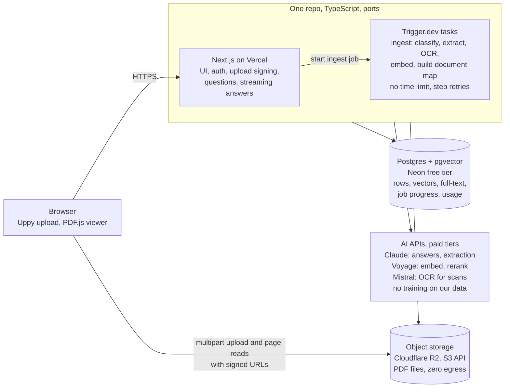

# Consta — MVP PRD

Sep 26, 2026 · Cleiton da Silva Baloneker · Live version: [Claude Doc](https://claude.ai/code/artifact/9324b97f-1bd7-4d40-90c8-06a7b2997ec3)

## Overview

Consta lets a lawyer upload one very large case file and ask questions. Every statement in the answer links to the source page. The MVP runs on one Next.js codebase, free-tier infrastructure, and pay-per-use AI. Each vendor sits behind an interface, so we can replace it without a rewrite.

**Problem.** A Brazilian case file can have 3,600 pages (about 400 MB, 2 to 3 million tokens). Some pages are digital text from PJe or e-SAJ, and some are scans. No model can read the full file in one request. Today the lawyer builds an index of the file by hand, and that takes hours. General chat tools give answers that the lawyer cannot check, and courts sanction lawyers for AI citations that do not exist.

**Target user.** The MVP has one pilot user: a litigation lawyer who works on one large case file for months. After the pilot, we sell to solo lawyers and small firms (5 to 10 paying accounts). Law firms with compliance needs come in version 2.

**Differentiator.** Every sentence in an answer can be checked against a page. A statement without a page reference is not shown.

### What this version changes from the first draft

| Area | First draft (prd.md) | This version |
| --- | --- | --- |
| Language and runtime | Python parser plus a Next.js frontend | One TypeScript codebase. Python is added only if the Phase 1 test shows the JS parser is not good enough. |
| Backend | Not decided | No always-on server. Next.js handles requests; a managed task runner handles ingest. |
| Vendors | Named per layer, with no exit path | Each vendor sits behind a port (interface). Every port has a named upgrade adapter. |
| Cost policy | Pay for AI during the MVP | Free tiers for infrastructure. AI is paid per use, because free AI tiers can train on client data. |
| Scope | Six product functions | The same six functions, plus login, quotas, usage metering and file deletion. We need these to charge money and to meet LGPD. |
| Monetization | Separate note | Usage metering from day one, so pricing comes from real cost data. |

The first draft's core analysis stays: the four main risks, the three question types, the page-reference rule, and building bottom-up.

## Goals, non-goals and success metrics

The MVP succeeds when the pilot lawyer uses Consta on a real case file every week and trusts its page references. It must also keep the fixed monthly cost at zero.

### Goals

1. **Trust.** Every statement shown has a page reference, and the lawyer confirms that the page holds the source.
2. **Large files work.** A 3,600-page mixed file goes from upload to a finished document map with no manual step.
3. **Value before the first question.** The document map replaces the lawyer's manual index.
4. **Low cost.** No fixed monthly infrastructure cost during the pilot. AI is paid only per page and per question.
5. **Replaceable vendors.** To swap a vendor, we write one new adapter and change config. Domain code does not change.

### Success metrics

| Metric | MVP target | How we measure it |
| --- | --- | --- |
| Correct page references | 90% or more on 20 real questions (18 of 20) | The lawyer opens each cited page and checks it |
| Statements without a page reference | 0 shown | Enforced in code; logged when a statement is dropped |
| Document map accuracy | 90% or more of peças found, with the correct type and page range | Compared with the lawyer's own index of one file |
| Extraction accuracy | 20 of 20 random pages readable and in the right order | Manual check against the PDF |
| Ingest time, 3,600 pages | Under 30 minutes | Timestamps on the `ingest_job` table |
| Upload resume | A 400 MB upload continues after a network stop | Manual test in Phase 4 |
| Variable cost per ingest | Under 10 USD per 3,600 pages | `usage_event` table |
| Fixed infrastructure cost | 0 USD per month during the pilot | Vendor invoices |
| Pilot engagement | Used in 3 or more of the first 4 weeks | Product analytics |

### Non-goals for the MVP

- Search across more than one case file
- Collaboration, comments, shared workspaces, teams
- Export to Word (the user can copy the text)
- A screen to correct OCR errors (we measure the error rate first)
- Saved chat history (we log questions for quality and cost only)
- User API keys (a version 2 enterprise tier, not a cost control)
- SSO, audit logs, on-premise install
- Mobile apps (the web app must still be usable on a tablet)

## MVP scope

The pilot needs ten Must features. Four Should features are needed before the first paying user. Everything else waits for a second paying user.

### Must: pilot release

| ID | Feature | User story | Acceptance criteria |
| --- | --- | --- | --- |
| F1 | Sign in | As a lawyer, I sign in with my email so only I see my case files. | Magic-link login. Each query filters by owner. A second account cannot open the first account's file, even by URL. |
| F2 | Upload a large PDF | As a lawyer, I upload a 400 MB PDF and it survives a network drop. | Direct multipart upload to object storage, 5 to 10 MB parts. Resume after a network stop. Limits: 500 MB and 5,000 pages per file. |
| F3 | Ingest with progress | As a lawyer, I see how far the processing is and I can close the tab. | Shows the stage and "page N of M". Progress comes from the database, not the browser. A failed page range retries 3 times, then the file shows `failed` with a reason. |
| F4 | Document map | As a lawyer, I see an index of the peças before I ask anything. | Table of peças: type, date, page range, 2 to 3 sentence summary. A click opens the first page in the viewer. |
| F5 | Ask about the full file | As a lawyer, I ask a question about the whole case file. | Needle questions use hybrid search and a reranker. List questions use the `fact` table. Each statement carries at least one page number. A statement without one is not shown. |
| F6 | Ask about one peça | As a lawyer, I pick a peça and ask about it. | The system reads the full page range of the peça. It does not search. It refuses a range above the token budget (about 150,000 tokens) and asks the user to narrow it. |
| F7 | Viewer with page references | As a lawyer, I click a page reference and see the source. | Opens the cited page. On digital pages it marks the source text. On scanned pages it shows the quoted text next to the page (see Open questions). |
| F8 | Summarize a peça or page range | As a lawyer, I get a summary of a sentença or a laudo. | A preset prompt on the F6 path. Every paragraph cites pages. |
| F9 | Delete a case file | As a lawyer, I delete a file and everything derived from it. | Removes the PDF, pages, chunks, vectors and facts. Storage is purged within 24 hours. The action is logged without file content. |
| F10 | Quota and usage metering | As the operator, I cap the cost of each account. | Page quota per account, checked before ingest. Each AI call writes a `usage_event` row with tokens, pages and cost. |

### Should: before the first paying user

| ID | Feature | Acceptance criteria |
| --- | --- | --- |
| S1 | Email when ingest ends | One email for `ready` or `failed`, with a link to the file. |
| S2 | Plans and billing | Stripe Checkout and Customer Portal. A plan sets the page quota. A webhook updates the plan. |
| S3 | Answer feedback | Thumbs up or down, plus a "wrong page" flag on each reference. Stored for the evaluation set. |
| S4 | Operator dashboard | Cost per account and per case file, taken from `usage_event`. A protected page or a saved SQL query is enough. |

### Later

Search across case files, teams and sharing, export to Word, an OCR correction screen, saved chat history, user API keys (enterprise tier), SSO.

### Question types and how each is answered

One retrieval method fails on two of the three question types. The user picks the scope with two controls: "whole file" or "this peça". We do not build a router model in the MVP.

| Type | Example | Method |
| --- | --- | --- |
| Needle | "Find each mention of Banco Safra." | Hybrid search (vector plus Portuguese full-text), Reciprocal Rank Fusion, then a reranker keeps the top 20 chunks |
| Scoped | "Summarize the sentença." | Read the full page range from the document map |
| Global | "List each witness." "Give me a timeline." | Query the `fact` table built at ingest, then the model writes the answer from the rows |

## Architecture decision: no separate backend

We do not build a separate backend service. Next.js on Vercel handles every request. Trigger.dev runs the ingest pipeline as background tasks. Both run code from the same repository and the same TypeScript packages.



The browser never sends file bytes through our server. Next.js only signs URLs, starts jobs and answers questions.

### Why this split

- **Next.js alone cannot run the ingest.** A Vercel Hobby function stops after 300 seconds, has 2 GB of memory and accepts a 4.5 MB request body. A 3,600-page ingest reads a 400 MB file for 20 to 40 minutes. ([Vercel limits](https://vercel.com/docs/functions/limitations))
- **An always-on backend costs money and adds work.** A NestJS or FastAPI service on a VM costs every month and is one more deploy target. At 1 to 10 users it gives nothing that a task runner does not give.
- **Trigger.dev fits the ingest.** Tasks have no timeout (14-day maximum), retry per step, and can run on larger machines. The free plan includes 5 USD of compute each month and 10 concurrent runs. It is Apache 2.0 and self-hostable, so it is not a lock-in. ([pricing](https://trigger.dev/pricing), [limits](https://trigger.dev/docs/limits))

### What runs where

| Work | Runs in | Reason |
| --- | --- | --- |
| Pages, login, case file list, document map | Next.js server components and server actions | Short requests |
| Start and finish a multipart upload | Next.js route handler that signs R2 URLs | The file goes from the browser to R2. The 4.5 MB body limit never applies. |
| Ingest pipeline | Trigger.dev tasks, one child task per range of 100 pages | Long, memory-heavy, needs retries |
| Ingest progress | Browser polls a Next.js endpoint every 3 seconds | Reads `ingest_job` rows. Upgrade path: Trigger.dev Realtime. |
| Questions and summaries | Next.js route handler that streams the answer | 5 to 90 seconds, under the 300-second limit |
| PDF pages in the viewer | Browser reads R2 directly with a signed URL and HTTP range requests | PDF.js loads only the pages it shows. No Vercel bandwidth. |

### Language: TypeScript first, Python only if needed

The first draft named PyMuPDF. We start with TypeScript only: pdf.js (through `unpdf`) reads text and positions, and `pdf-lib` splits pages. One language means one toolchain and one deploy. PyMuPDF is also AGPL-3.0, which is a license risk for a closed-source SaaS.

If the Phase 1 test shows that pdf.js mixes columns, we add a Python extraction task (pypdfium2 or Docling) behind the same `TextExtractor` port. Trigger.dev can run Python inside a task, so the deployment does not change.

### Commercial-use constraint

The Vercel Hobby plan is for non-commercial, personal use only. ([Hobby plan](https://vercel.com/docs/plans/hobby)) A free pilot fits. Before the first invoice we move to Vercel Pro (20 USD per seat per month), or we run the Next.js standalone build as a container on another host.

## Tech stack and the abstraction layer

Every external service sits behind a port: a TypeScript interface in `packages/core`. The MVP uses a free adapter, or a pay-per-use one when the free tier would train on client data. Each port names its upgrade adapter and the signal that tells us to switch.

### Ports, adapters and upgrade triggers

| Port | MVP adapter | Free-tier limit or price | Upgrade adapter | Switch when |
| --- | --- | --- | --- | --- |
| Hosting | Vercel Hobby | 300 s functions, 4 CPU-hours active CPU per month, non-commercial only | Vercel Pro (20 USD per seat per month), or the Next.js standalone container on Cloud Run or Fly.io | Before the first paid invoice |
| `JobRunner` | Trigger.dev Cloud, Free | 5 USD compute credit per month, 10 concurrent runs, 1-day logs | Trigger.dev paid plan, self-hosted Trigger.dev, or pg-boss on a container | Compute above 5 USD per month |
| `ObjectStorage` | Cloudflare R2 (S3 API) | 10 GB-month, 1M writes, 10M reads, free egress | R2 paid (0.015 USD per GB-month), or AWS S3 in São Paulo (`sa-east-1`): same S3 client | More than 8 GB stored, or a customer requires storage in Brazil |
| Database (Drizzle on plain Postgres) | Neon Free | 0.5 GB per project, 100 CU-hours per month, suspends after 5 minutes idle | Neon Launch (0.35 USD per GB-month, 0.106 USD per CU-hour, no minimum), Supabase Pro (25 USD per month), or any Postgres 16+ with pgvector | More than 0.4 GB stored |
| `SearchIndex` | pgvector HNSW plus Postgres full-text (`portuguese`), fused with RRF in one SQL statement | Inside the database | ParadeDB BM25, or a vector database (Qdrant) | p95 search above 500 ms |
| `TextExtractor` | pdf.js through `unpdf` (Apache-2.0) | Free | Python task with pypdfium2 or Docling | Phase 1 extraction test fails |
| `OcrProvider` | Mistral OCR 4 API | 4 USD per 1,000 pages, 2 USD with Batch. Returns bounding boxes. | Mistral OCR 3 (2 USD per 1,000), a self-hosted OCR container, or a cloud Document AI | OCR cost above 30% of revenue |
| `Embedder` | Voyage `voyage-4-lite`, 1,024 dimensions | 0.02 USD per million tokens, first 200M tokens free | `voyage-4` or another multilingual model (needs a re-embed job) | Retrieval eval below target |
| `Reranker` | Voyage `rerank-3-lite` | 0.02 USD per million tokens, first 200M free | `rerank-3` or Cohere Rerank | Retrieval eval below target |
| `LlmClient`, role `extract` | Claude Haiku 4.5 through the Message Batches API | 1 / 5 USD per million tokens in / out, 50% off in batch | Any cheaper model that passes the document map eval | Always tested against the eval set |
| `LlmClient`, role `answer` | Claude Opus 5 with Citations | 5 / 25 USD per million tokens in / out | Claude Sonnet 5 (2 / 10 USD) if it passes the same eval | Answer cost above target |
| `Auth` | Better Auth (open source), magic link, sessions in our Postgres | Free | Add the SSO plugin, or WorkOS for enterprise SSO | First firm that needs SSO |
| `Mailer` | Resend Free | 3,000 emails per month, 100 per day | Resend Pro (20 USD per month) or Amazon SES | More than 80 emails per day |
| `Billing` (Should) | Stripe Checkout and Customer Portal | No monthly fee | Local provider for Pix or boleto | Brazilian customers ask for Pix |

**No free AI tiers for client data.** Mistral's free Experiment tier and Voyage's default terms can use API data for training. We use paid Mistral (no training by default) and turn on Voyage's training opt-out, which needs a payment method on file. Anthropic's commercial API does not train on inputs by default. This is an LGPD and professional-secrecy requirement, so it is not optional.

Sources: [Vercel Hobby](https://vercel.com/docs/plans/hobby) · [Trigger.dev pricing](https://trigger.dev/pricing) · [Neon plans](https://neon.com/docs/introduction/plans) · [R2 pricing](https://developers.cloudflare.com/r2/pricing/) · [Mistral OCR 4](https://mistral.ai/news/ocr-4/) · [Voyage pricing](https://docs.voyageai.com/docs/pricing) · [Voyage FAQ on opt-out](https://docs.voyageai.com/docs/faq) · [Mistral training opt-out](https://help.mistral.ai/en/articles/347614-can-i-opt-out-of-my-input-or-output-data-being-used-for-training) · [Resend pricing](https://resend.com/pricing)

### Alternatives considered

Supabase and AWS S3 are good options. We start with Neon and R2 because the pilot fits in their free tiers, and each alternative is one adapter or one database move away.

| Option | Strengths | Why not in the MVP | When to revisit |
| --- | --- | --- | --- |
| Supabase Free (database, auth, storage) | One vendor and one dashboard for Postgres, auth and files. 500 MB database, 50,000 auth users per month. | Storage caps one upload at 50 MB, and our files reach 500 MB. Only 1 GB of storage and 5 GB of egress. Projects pause after 1 week of inactivity. | Not for this product |
| Supabase Pro | 25 USD per month: 8 GB database, 100 GB storage, 500 GB maximum upload, 250 GB egress, no pausing | A fixed cost from day one, while the pilot fits in free tiers | When one vendor is worth more than a 0 USD fixed cost, for example at the first paying customer. The move is a `pg_dump` and restore; Drizzle code does not change. |
| Supabase Auth | Ready-made login with 50,000 users per month on Free | User ids live in `auth.users` and row-level security policies call `auth.uid()`. Leaving later means migrating users and rewriting policies. Better Auth keeps users in our own tables. | If we move to Supabase Pro and accept that coupling |
| Supabase Stripe integration | Syncs Stripe data into Postgres for SQL queries (to confirm) | Checkout, webhooks and the plan-to-quota logic are still ours to write | Phase 6, if Stripe reporting in SQL helps |
| AWS S3 | Mature features (lifecycle rules, events, Object Lock) and a São Paulo region (`sa-east-1`) | No permanent free tier: new accounts get up to 200 USD in credits for 6 months. Egress is charged after 100 GB per month. | When a customer requires files stored in Brazil. Same S3 API: change the endpoint and credentials, then copy the files with rclone. |

**Data residency.** R2 has no South American location. Its location hints cover North America, Europe, Asia-Pacific and Oceania, and its jurisdictions are the EU, the US and FedRAMP. LGPD allows storage abroad when the international transfer is disclosed. Our AI providers already process data outside Brazil, so S3 in São Paulo does not remove that disclosure. It does answer firms that ask for files stored in Brazil.

Sources: [Supabase pricing](https://supabase.com/pricing) · [R2 data location](https://developers.cloudflare.com/r2/reference/data-location/) · [S3 pricing](https://aws.amazon.com/s3/pricing/)

### Repository layout

```text
apps/web            Next.js: pages, route handlers, server actions
apps/jobs           Trigger.dev task definitions (thin: call use cases in core)
packages/core       entities, use cases, port interfaces; no vendor imports
packages/adapters   one folder per vendor: r2, voyage, anthropic, mistral-ocr, trigger, resend
packages/db         Drizzle schema, migrations, SQL for hybrid search
packages/evals      test questions, expected pages, scoring scripts
```

### Rules that keep the abstraction honest

1. `packages/core` never imports a vendor SDK. A lint rule (`no-restricted-imports`) fails the build if it does.
2. One composition root per runtime (`apps/web`, `apps/jobs`) picks adapters from environment variables, for example `OCR_PROVIDER=mistral`.
3. Each port has a contract test suite. Every adapter must pass it, and an in-memory fake passes it too for fast unit tests.
4. Every AI port returns usage (tokens, pages, cost in USD) with its result. The use case writes it to `usage_event`. This makes metering vendor-independent.
5. We store `embedding_model` on each chunk. A model change then becomes a background re-embed job, not a migration.
6. Ports are shaped by our domain, not by the vendor. We do not add a port until two adapters could plausibly exist.

```ts
// packages/core/ports.ts (sketch)
export interface OcrProvider {
  ocrPages(pdf: Uint8Array, pages: number[]): Promise<Metered<PageText[]>>;
}
export interface LlmClient {
  complete(role: "extract" | "answer", req: LlmRequest): Promise<Metered<LlmAnswer>>;
}
export interface SearchIndex {
  hybrid(caseFileId: string, query: string, embedding: number[], k: number): Promise<ChunkHit[]>;
}
export type Metered<T> = { value: T; usage: { provider: string; units: number; unit: "token" | "page"; costUsd: number } };
```

## Data model and key flows

Eight domain tables in one Postgres database hold everything, including vectors, full-text indexes, job progress and cost. Better Auth adds its own `user`, `session`, `account` and `verification` tables.

### Tables

| Table | One row per | Main columns |
| --- | --- | --- |
| `case_file` | Uploaded PDF | id, owner_id, name, storage_key, size_bytes, page_count, status (`uploading`, `queued`, `processing`, `mapping`, `ready`, `failed`, `deleting`), pages_done, error, deleted_at |
| `ingest_job` | Range of 100 pages | id, case_file_id, run_id, page_from, page_to, stage, status, attempts, started_at, finished_at |
| `page` | PDF page | case_file_id, page_number, source (`digital`, `scan`), text, blocks (jsonb: text and bounding box), ocr_confidence |
| `chunk` | Search unit, never across a page break | id, case_file_id, page_number, text, tsv (generated, `portuguese` config), embedding (`halfvec(1024)`), embedding_model, block_ids |
| `peca` | Document in the document map | id, case_file_id, type, title, date, first_page, last_page, summary, confidence |
| `fact` | Fact for list questions | id, case_file_id, page_number, kind (person, role, date, amount, event), value, normalized_value, context |
| `question` | Question asked | id, case_file_id, owner_id, scope, peca_id, text, answer (statements with page citations), feedback, created_at |
| `usage_event` | Metered AI call | id, owner_id, case_file_id, kind (`ocr`, `embed`, `rerank`, `extract`, `answer`), provider, model, units, unit, cost_usd, created_at |

**Design notes**

- **A chunk never crosses a page break.** Each chunk then has exactly one page number, and a citation maps to one page without ambiguity.
- **Indexes.** HNSW on `chunk.embedding` (`halfvec_cosine_ops`), GIN on `chunk.tsv`, and B-tree on `(case_file_id, page_number)`. Vector search always filters by `case_file_id`. We use pgvector 0.8 iterative index scans and check recall in Phase 2.
- **Size per case file.** About 60 to 80 MB for 3,600 pages: roughly 6,000 chunks, 1,024-dimension half-precision vectors, text and block positions. This is an estimate; we measure it in Phase 1. Neon Free (0.5 GB) holds about 5 case files, which is the first upgrade trigger.
- **Tenancy.** Every repository function takes `ownerId` and filters by it. We add Postgres row-level security when teams arrive.
- **Deletion (F9).** A task deletes rows in order (chunk, fact, peca, page, question, ingest_job, case_file), then the R2 object. It keeps only the `usage_event` rows, which hold no content.

### Ingest flow

1. The browser asks Next.js to start an upload. Next.js checks the page quota, creates `case_file` (`uploading`) and opens an R2 multipart upload.
2. Uppy sends 10 MB parts straight to R2 with signed URLs. On completion, Next.js closes the multipart upload, reads the page count, sets `queued` and calls `JobRunner.startIngest`.
3. The parent task creates one `ingest_job` per 100 pages and starts the child tasks in parallel.
4. Each child task classifies each page. Digital pages go to `TextExtractor`. Scanned pages are copied into a small PDF with `pdf-lib` and sent to `OcrProvider`.
5. The child writes `page` rows, splits text into chunks inside each page, embeds them in batches and writes `chunk` rows. It updates `ingest_job` after every page.
6. When every range is done, the map task runs Claude Haiku 4.5 through the Batch API. It finds each peça's boundaries, type and date, writes a summary, and extracts facts. It writes `peca` and `fact` rows and sets `ready`.

### Query flow: whole file

1. Embed the question with the `query` input type.
2. One SQL statement takes the top 50 by vector distance and the top 50 by full-text rank in this case file, and fuses them with Reciprocal Rank Fusion.
3. The reranker keeps the best 20 chunks.
4. Next.js sends the 20 chunks to Claude as a custom-content document with citations turned on. Each content block is one chunk, labelled with its page number.
5. Each citation points to a content block, so it maps to one chunk, one page and its bounding boxes. A statement with no citation is removed before display.
6. The answer streams to the browser. The question, the citations and the usage are saved.

Quick actions (Timeline, People, Amounts) skip the search. They read the `fact` table, and Claude writes the answer from those rows, each row carrying its page.

### Query flow: one peça

1. Load the page texts from `first_page` to `last_page` of the peça.
2. Count tokens. Above about 150,000 tokens, ask the user to pick a smaller page range.
3. Send the pages as one custom-content document, one content block per page, with citations on and prompt caching on the document. Follow-up questions about the same peça then read the cached pages at a lower price.
4. Apply the same rule: no citation, no statement.

## Deployment, environments and cost

One push to `main` deploys everything: Vercel builds the web app, and a GitHub Action migrates the database and deploys the Trigger.dev tasks. The fixed cost is 0 USD during the pilot and about 20 to 30 USD per month after the first paying customer.

### Environments

| Environment | Web | Tasks | Database | Storage | AI |
| --- | --- | --- | --- | --- | --- |
| Local | `next dev` | `trigger dev` (runs tasks on the laptop) | Postgres with pgvector in Docker, or a Neon branch | Separate R2 bucket, or MinIO in Docker (same S3 adapter) | Fakes for unit tests; real keys with low spend limits for manual tests |
| Preview (per pull request) | Vercel preview deploy | Not connected; UI and query work only | Neon branch per pull request (10 branches on Free) | Dev bucket | Real keys with low spend limits |
| Production | Vercel, region `gru1` (São Paulo) | Trigger.dev production environment | Neon, São Paulo region | Production R2 bucket, CORS limited to our domain | Production keys with training opt-out and monthly spend limits |

Put the web functions and the database in the same region. Each question makes several database round trips, so this distance matters more than distance to the user.

### CI/CD with GitHub Actions

1. **On every pull request:** typecheck, lint (with the no-vendor-import rule), unit tests with fakes, and a Drizzle migration check against the preview Neon branch.
2. **On merge to `main`:** run `drizzle-kit migrate` on production. Then run `trigger.dev deploy`. Vercel deploys the web app from the same commit.
3. **Migrations are backward-compatible.** Add columns first and remove them in a later release. Old tasks and a new web app can then run at the same time.
4. **Nightly (optional):** adapter contract tests against the real vendor APIs with a small fixture PDF.
5. **Before each release to the pilot:** run the evaluation set in `packages/evals` by hand and compare scores with the last release.

### Operations

- **Secrets** live in Vercel and Trigger.dev environment settings, never in the repository.
- **No case content in logs.** Error reports and logs hold ids and counts, never page text, questions or answers. Scrubbing runs before any external error tool.
- **Logs.** Vercel Hobby keeps runtime logs for 1 hour and Trigger.dev Free keeps them for 1 day. Durable facts (job status, errors, cost) go to our own tables.
- **Spend guards.** Monthly spend limits at Anthropic, Mistral and Voyage. Page quota per account. Vercel Hobby stops a feature at its limit instead of billing.

### Variable cost per case file

These numbers are estimates from list prices for a 3,600-page file. Phase 1 replaces them with measured values.

| Item | Assumption | Cost (USD) |
| --- | --- | --- |
| OCR | All 3,600 pages scanned; Mistral OCR 4 at 4 USD per 1,000 (2 USD in batch) | 7.20 to 14.40 |
| OCR | 30% scanned | 2.20 to 4.30 |
| Embeddings | About 3M tokens at 0.02 USD per million (free inside the first 200M) | Under 0.10 |
| Document map and facts | About 3M tokens in, 0.3M out, Claude Haiku 4.5 in batch (0.50 / 2.50 USD per million) | About 2.30 |
| Task compute | 20 to 40 minutes of Trigger.dev machine time | Under 1 (to be measured) |
| **Ingest total** | 30% scanned to fully scanned | **About 5 to 18** |
| Whole-file question | About 12,000 tokens in, 1,000 out, Claude Opus 5, plus rerank | About 0.10 |
| Peça question, first | About 80,000 tokens in, 2,000 out, Claude Opus 5 | About 0.55 (includes the cache write) |
| Peça question, follow-up | Same pages read from the prompt cache | About 0.10 |

The ingest is paid once, and a lawyer works on one case file for months. The scan share of real files decides most of the cost. Getting sample files is therefore still the first task.

### When fixed costs start

| Trigger | Change | New fixed cost |
| --- | --- | --- |
| First paying customer | Vercel Hobby to Pro (commercial use) | 20 USD per month |
| Database above 0.4 GB (about 5 case files) | Neon Free to Launch | About 0.35 USD per GB-month plus compute; a few USD per month at 10 case files |
| More than 8 GB of PDFs | R2 paid storage | 0.015 USD per GB-month |
| More than 100 emails per day | Resend Pro | 20 USD per month |
| Task compute above 5 USD per month | Trigger.dev paid plan | Plan price, confirm at the time |

## Monetization

We charge by pages ingested, because pages drive the cost. Questions are included with a fair-use limit. The MVP builds only the hooks: a page quota per account (F10) and a `usage_event` row for every AI call. Stripe comes in Phase 6.

| Plan | For | Includes | Price rule |
| --- | --- | --- | --- |
| Trial | A new lawyer testing the product | 1 case file up to 500 pages, 30 questions | Free; worst-case cost about 3 USD |
| Pro | Solo lawyer | Monthly page quota, questions with fair use, extra page packs | Price of at least 3 times the variable cost of a fully used quota |
| Enterprise (version 2) | Law firm | Higher quotas, SSO, data processing agreement, the firm's own AI provider contract (user API keys) | Per contract; lower margin for a larger account |

Worked example of the price rule: if Phase 1 measures 3 USD per 1,000 pages, a Pro plan with 5,000 pages has at most 15 USD of variable cost. Its price should then be at least 45 USD per month. The pilot's `usage_event` data sets the real numbers.

## Risks

| Risk | Effect | Mitigation |
| --- | --- | --- |
| Bad text extraction | Mixed columns put wrong text in the index, and every answer above it is wrong | Classify pages; Phase 1 gate of 20 of 20 pages; Python extractor behind the same port if pdf.js fails |
| Incomplete retrieval | An answer from 20 of 6,000 chunks looks complete but is not | `fact` table and quick actions for list questions; scoped reads for peças |
| Wrong or missing page reference | The lawyer cannot check the answer and faces sanctions | Claude citations on page-labelled blocks; drop any statement with no citation; Phase 2 gate |
| Long ingest with no feedback | The user thinks it failed and uploads again | Page-level progress from `ingest_job`; email when done |
| Vendor price changes | OCR 4 costs 4 times the first draft's 1 USD per 1,000 pages estimate | Every vendor behind a port; cost per page tracked in `usage_event` |
| Free-tier limits | Neon Free fills at about 5 case files; Vercel Hobby forbids commercial use | Upgrade triggers are listed with their cost; the first paid month costs about 20 to 30 USD |
| Client data used for training | LGPD and professional-secrecy breach | Paid AI tiers only, training opt-outs on, listed in the data statement |
| Filtered vector search recall | HNSW with a `case_file_id` filter can miss results | pgvector iterative scans; recall check in Phase 2; partition by case file if needed |

**Data statement before the first upload.** Write down where the file is stored and in which country, and which services read it (Anthropic, Voyage, Mistral). Say that they do not train on it, how the user deletes a file, and how long deleted data stays. AI processing happens outside Brazil, so the statement must name that international transfer. Ask an LGPD specialist to review it before the first paying customer.

## Milestones

We build from the bottom up, as the first draft said. Each gate is a test that must pass before the next phase starts. The product shell (Phase 4) comes after the three phases that prove the answers are correct.

```mermaid
flowchart TD
  P0["0 · Samples and skeleton (1 week)<br/>Real files, repo, ports, CI, eval set"] --> G0{{"Gate: 3 to 5 real case files in hand<br/>20 real questions with expected pages"}}
  G0 --> P1["1 · Ingest one real file (1 to 2 weeks)<br/>Tasks only, no UI: classify, extract, OCR, chunk"] --> G1{{"Gate: 20 of 20 random pages correct<br/>Cost and time per 1,000 pages recorded"}}
  G1 --> P2["2 · Retrieval and citations (1 to 2 weeks)<br/>Hybrid search, rerank, Claude citations"] --> G2{{"Gate: 18 of 20 questions cite the right page<br/>p95 search under 500 ms"}}
  G2 --> P3["3 · Document map (1 week)<br/>Peça boundaries, summaries, facts"] --> G3{{"Gate: lawyer confirms 90% of peças<br/>Page ranges match her own index"}}
  G3 --> P4["4 · Product shell (1 to 2 weeks)<br/>Login, upload, progress, quota, delete"] --> G4{{"Gate: 400 MB upload resumes after a drop<br/>Delete removes every derived row"}}
  G4 --> P5["5 · Viewer and pilot release (1 week)<br/>Page viewer with marks, pilot lawyer onboarded"] --> G5{{"Gate: 10 of 10 references open the right text<br/>Lawyer uses it in 3 of the first 4 weeks"}}
  G5 --> P6["6 · Paid beta (1 week)<br/>Stripe, emails, Vercel Pro, answer feedback"] --> G6{{"Gate: first paying customer<br/>Price covers 3 times the measured cost"}}
```



Durations are estimates for one full-time engineer (about 8 to 10 weeks in total). Phase 0 cannot finish without the sample files.

## Open questions

Answer these with the pilot lawyer before Phase 1. The first one decides the cost, the speed and the quality of the whole system.

- [ ] What share of pages are scans? Get 3 to 5 real case files and check them page by page.
- [ ] Where do the files come from: a PJe or e-SAJ export, a paper scan, or an email from a client?
- [ ] What does the lawyer do today with a new case file, hour by hour?
- [ ] Which question does she ask most often about a file of this size?
- [ ] Does she accept an answer that she cannot check against a page? Record her answer in her own words.
- [ ] How many case files does she open each month? This sets the quota and the price.
- [ ] On scanned pages, is a mark around the OCR text block enough, or does she need the exact line? (F7)
- [ ] What would she pay per month, and how: card, Pix or boleto?
- [ ] Does `voyage-4-lite` handle legal Portuguese well enough? Compare it with `voyage-4` on the 20-question set in Phase 2.
--resume bc6e0155-5127-4f96-83e3-606259d2b322
- [ ] Will the first customers require case files stored in Brazil? If yes, the `ObjectStorage` adapter moves to S3 in São Paulo before launch.
